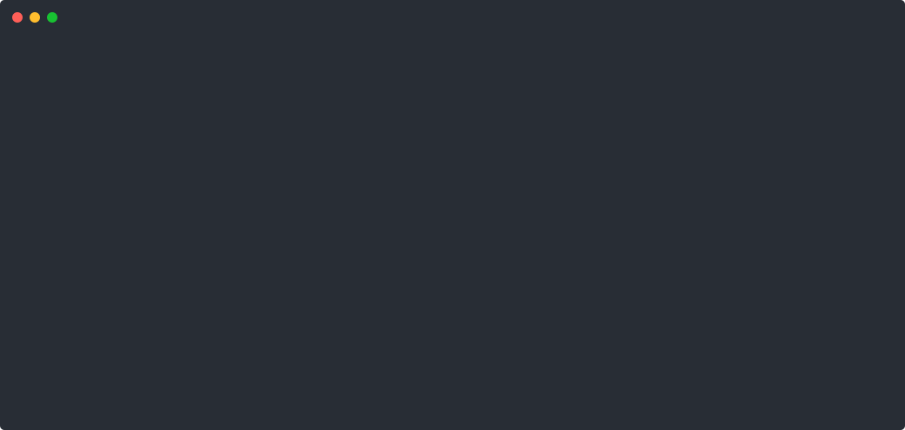

# Screenshots and Dashboards

## Overview

Recorded demo assets for the self-healing remediation path live under `docs/assets/`.
There is no placeholder image in this repository.

## Remediation demo

Fault inject → detect → remediate (crash-heal path), as captured for the CI-backed Results section:

- SVG: [docs/assets/chaos-remediation.svg](assets/chaos-remediation.svg)
- asciinema cast: [docs/assets/chaos-remediation.cast](assets/chaos-remediation.cast)

Measured timings for that path: [results.md](results.md) · claim mapping: [EVIDENCE.md](EVIDENCE.md).

## Monitoring and chaos UIs

Operational UIs (Grafana, Prometheus, Chaos Mesh dashboard) are deployed with the stack.
Use the access commands in the repository README under **Accessing Services** when a local or CI cluster is running.
Do not treat missing PNG screenshots as evidence of metrics or uptime.
